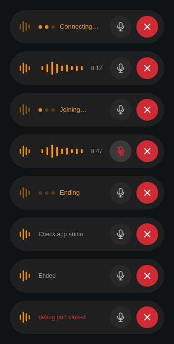

# Grok Bot Voice

Start, mute and end Grok Bot voice calls from an Omarchy hotkey without changing keyboard focus.



## Install

Requires Omarchy, Node.js 24 or later, socat and flock. Sign in to Grok Bot,
then launch it with the local debug port:

```sh
grok-bot --remote-debugging-port=9222
```

Add the same argument to your app launcher.

```sh
git clone https://github.com/StefMVP/omarchy-grokbot-voice.git
cd omarchy-grokbot-voice
bin/grokbot-voice install
mkdir -p "${XDG_CONFIG_HOME:-$HOME/.config}/grokbot-voice"
cp config.example.json "${XDG_CONFIG_HOME:-$HOME/.config}/grokbot-voice/config.json"
```

Set `bot.agentId` in the config file. In Grok Bot's DevTools, inspect the bot's
list button and copy its `data-agent-id` value.

```sh
grokbot-voice setup hyprland 'SUPER + grave'
hyprctl reload
hyprctl configerrors
grokbot-voice doctor
```

Choose an unused key or check its current action first. Press the key to start
or end a call. Use the pill to mute the microphone or hang up.

## Configure

Settings use `$XDG_CONFIG_HOME/grokbot-voice/config.json`, with `~/.config` as
the default. Set `GROKBOT_VOICE_CONFIG` in the session environment to use
another absolute path. Keep bot settings outside Git.

See [config.example.json](config.example.json) for settings. `app.debugPort`
must match the launcher. `call.position` is `top` or `bottom`;
`call.margin` is in pixels.

Grok Bot handles audio. The optional PipeWire stream check uses `pw-dump` and
`app.processBinary`. Set `audio.enabled` to `false` to disable it. If the pill
shows Check app audio, check the microphone and output in Grok Bot.

## Remove

```sh
grokbot-voice hangup
grokbot-voice shutdown
grokbot-voice uninstall
hyprctl reload
hyprctl configerrors
```

Uninstall keeps the checkout and settings. Run `grokbot-voice --help` for commands.
